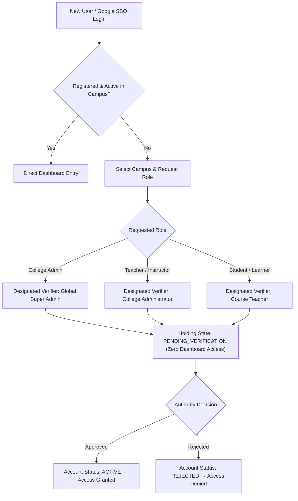

# EduSphere — Enterprise Multi-Tenant SaaS Learning Management System

[](https://www.typescriptlang.org/)
[](https://react.dev/)
[](https://nodejs.org/)
[](https://vitejs.dev/)
[](https://mui.com/)
[](https://expressjs.com/)
[](https://www.mongodb.com/)
[](https://redis.io/)
[](https://socket.io/)
[](https://www.docker.com/)
[](https://vitest.dev/)

---

## 1. Executive Summary

**EduSphere** is a high-concurrency, production-grade, multi-tenant Software-as-a-Service (SaaS) Learning Management Platform. It enables universities, colleges, and educational institutions to operate within their own isolated tenant partition with custom domain mapping, dedicated branding, multi-tier hierarchical identity verification, automated course delivery, timed assessments, and real-time collaboration.

### Core Architectural Pillars
- **Strict Logical Tenant Isolation:** Dedicated tenant scoping at middleware and repository levels guarantees zero cross-tenant data leakage with automated database filtering.
- **Enterprise 6-Tier Architecture:** Clean separation of concerns: `Route` $\rightarrow$ `Middleware` $\rightarrow$ `Controller` $\rightarrow$ `Service` $\rightarrow$ `Repository` $\rightarrow$ `Database`.
- **Advanced Identity & Cryptography:** Dual-token JWT (15-minute access token) with cryptographically random refresh token family rotation, Redis token reuse detection, Argon2id password hashing, and Google Workspace SSO integration.
- **3-Tier Hierarchical Approval Protocol:** Strict verification gates preventing unauthorized campus access:
  - **College Administrators** verified by **Global Super Admin**
  - **Faculty Instructors** verified by **College Administrators**
  - **Students / Learners** verified by **Course Instructors**
- **Real-Time Event Gateway:** Socket.IO WebSocket server for instant campus announcements, live chat broadcasts, and gradebook updates.
- **Sub-10ms Redis Caching:** Redis cache-aside implementation with selective TTL and automated tag-based cache invalidation.
- **Luxury Editorial Frontend:** React 18, Vite, Material UI (MUI v6) with customized luxury design tokens, Redux Toolkit state management, and responsive layouts.

---

## 2. Multi-Tier Hierarchical Verification Protocol

To prevent unauthorized access and maintain academic governance, EduSphere employs a strict 3-tier approval hierarchy. When a user authenticates via Google Workspace SSO or registers on a campus, their account is placed into a `PENDING_VERIFICATION` holding state until approved by their designated authority:



### Security Gates Enforced
1. **Zero Access While Pending:** Unverified accounts cannot retrieve JWT tokens or access any private dashboard API endpoints.
2. **Cross-Tenant Authorization Block:** An administrator of College A cannot view, approve, or reject accounts belonging to College B (`CROSS_TENANT_VIOLATION`).
3. **Self-Approval Prohibited:** Users cannot approve their own accounts (`SELF_APPROVAL_PROHIBITED`).
4. **Rate Limiting:** Redis-backed rate limiters enforce 15 auth requests/minute on login/SSO endpoints and 200 requests/minute on general API routes.

---

## 3. Technology Stack

### Frontend Architecture
- **Framework & Runtime:** React 18 with TypeScript 5.6
- **Tooling & Bundler:** Vite 5.4 (optimized code-splitting with manual vendor chunking)
- **Component System:** Material UI (MUI v6) + Emotion Styled Engine
- **State Management:** Redux Toolkit 2.2 + Typed Hooks
- **Data Fetching & Cache:** TanStack React Query v5
- **Forms & Validation:** React Hook Form 7.53 + Zod 3.23
- **Data Visualization:** Recharts 2.12
- **Real-Time Client:** Socket.IO Client 4.8
- **Icons:** Material UI Icons & Lucide React

### Backend Architecture
- **Runtime:** Node.js 22 LTS
- **Web Framework:** Express 4.21 with TypeScript
- **Database & ODM:** MongoDB 8.x + Mongoose 8.7
- **Caching & Broker:** Redis 7.x / ioredis 5.4
- **Real-Time Gateway:** Socket.IO 4.8 with tenant-scoped rooms
- **Security & Password Hashing:** Argon2id (`argon2` 0.41), JSON Web Tokens (`jsonwebtoken` 9.0), Helmet, CORS, Cookie-Parser
- **Request Validation:** Zod schema middleware
- **Structured Logging:** Winston 3.14 + Morgan HTTP logging

### Testing & DevOps
- **Unit & Integration Testing:** Vitest 2.1, Supertest 7.0
- **E2E Browser Automation:** Playwright
- **Containerization:** Docker multi-stage builds & Docker Compose
- **Web Server:** Nginx (reverse proxy & static gzip/brotli delivery)

---

## 4. Role-Based Access Control (RBAC) Matrix

| Platform Capability | Super Admin (`SUPER_ADMIN`) | College Admin (`TENANT_ADMIN`) | Faculty (`INSTRUCTOR`) | Student (`STUDENT`) |
|:---|:---:|:---:|:---:|:---:|
| **Provision & Suspend Institutions** | Yes | No | No | No |
| **Verify College Administrators** | Yes | No | No | No |
| **Verify Instructors** | Yes | Yes (Own Campus) | No | No |
| **Verify Students** | Yes | Yes (Own Campus) | Yes (Own Campus) | No |
| **Create & Author Courses** | Yes | Yes | Yes | No |
| **Create Timed Quizzes & Assessments** | Yes | Yes | Yes | No |
| **Grade Quizzes & Export Gradebook** | Yes | Yes | Yes | No |
| **Enroll into Courses** | No | No | No | Yes |
| **Attempt Quizzes & Submit Work** | No | No | No | Yes |
| **Broadcast Campus Announcements** | Yes | Yes | Yes | No |
| **Cross-Tenant Telemetry & Logs** | Yes | No | No | No |

---

## 5. Repository Structure

```text
Full-Stack-Enterprise-Web-Platform/
├── .github/
│   └── workflows/
│       ├── ci.yml                 # Automated Lint, Unit Tests, and Build Pipeline
│       └── cd.yml                 # Container deployment workflow
├── backend/
│   ├── src/
│   │   ├── config/                # Environment, Mongoose, Redis configs
│   │   ├── controllers/           # HTTP Request Handlers (Auth, Tenant, User, Course, Quiz)
│   │   ├── middleware/            # Tenant, Auth, RBAC, Rate-limit, Cache middlewares
│   │   ├── models/                # Schemas (Tenant, User, Course, Quiz, Announcement, Token)
│   │   ├── repositories/          # Scoped repositories with auto-injected tenant filter
│   │   ├── routes/v1/             # REST API v1 Endpoints
│   │   ├── schemas/               # Zod validation schemas
│   │   ├── services/              # Domain logic (Auth, User, Course, Quiz, Announcement)
│   │   ├── sockets/               # Real-time WebSocket handlers and tenant rooms
│   │   ├── types/                 # Shared TypeScript interfaces & declarations
│   │   ├── utils/                 # JWT, Argon2id hashing, Pagination, API response wrappers
│   │   ├── app.ts                 # Express application setup
│   │   └── server.ts              # HTTP & WebSocket startup entrypoint
│   ├── tests/
│   │   ├── unit/                  # Unit tests (Password, JWT, RBAC, Pagination)
│   │   └── integration/           # Integration tests (Tenant isolation, Auth)
│   ├── Dockerfile                 # Backend production container
│   ├── package.json
│   └── tsconfig.json
├── frontend/
│   ├── src/
│   │   ├── app/                   # App root component and providers
│   │   ├── config/                # Client configurations (Firebase SDK, API endpoints)
│   │   ├── layouts/               # Dashboard, Public, and Auth layout wrappers
│   │   ├── pages/                 # Views (LandingPage, LoginPage, DashboardPage)
│   │   ├── routes/                # Protected route guards and navigation setup
│   │   ├── services/              # API client, WebSocket, and persistent storage services
│   │   ├── store/                 # Redux Toolkit store and auth slices
│   │   ├── theme/                 # Editorial luxury design tokens and MUI theme
│   │   └── types/                 # Frontend TypeScript models
│   ├── public/                    # Static assets
│   ├── Dockerfile                 # Frontend multi-stage container
│   ├── nginx.conf                 # Nginx SPA reverse proxy configuration
│   ├── package.json
│   └── vite.config.ts
├── docs/                          # Architecture, ADRs, Security & API specifications
├── scripts/
│   └── load-testing/              # k6 stress and load testing scripts
├── docker-compose.yml             # Development orchestration (App, MongoDB, Redis)
└── README.md
```

---

## 6. REST API Reference (v1)

### Authentication & Identity
| Method | Endpoint | Access | Description |
|:---|:---|:---|:---|
| `POST` | `/api/v1/auth/login` | Public | Password login with Argon2id check & token rotation |
| `POST` | `/api/v1/auth/sso/google` | Public | Google SSO sign-in or hierarchical role registration |
| `POST` | `/api/v1/auth/refresh` | Public | Rotates refresh token and issues fresh access token |
| `POST` | `/api/v1/auth/logout` | Authenticated | Revokes active refresh token family in Redis |
| `GET`  | `/api/v1/auth/me` | Authenticated | Returns current authenticated user profile |

### Tenant Administration
| Method | Endpoint | Access | Description |
|:---|:---|:---|:---|
| `GET`  | `/api/v1/tenants/public` | Public | Lists active campuses for login selection |
| `GET`  | `/api/v1/tenants` | Super Admin | Lists all tenants with student statistics |
| `POST` | `/api/v1/tenants` | Super Admin | Provisions a new campus institution with domain |
| `DELETE`| `/api/v1/tenants/:id` | Super Admin | Decommissions institution and removes tenant data |

### User Management & Hierarchical Verification
| Method | Endpoint | Access | Description |
|:---|:---|:---|:---|
| `GET`  | `/api/v1/users` | Tenant Admin+ | Scoped roster of users within institution |
| `GET`  | `/api/v1/users/pending-verifications` | Verifier Authority | Retrieves pending role requests for approval |
| `POST` | `/api/v1/users/:id/approve` | Verifier Authority | Approves pending user and activates workspace access |
| `POST` | `/api/v1/users/:id/reject` | Verifier Authority | Rejects pending registration request |
| `POST` | `/api/v1/users/reset-password` | Authorized Role | Resets credentials according to RBAC rules |
| `DELETE`| `/api/v1/users/:id` | Tenant Admin+ | Removes user from tenant roster |

### Courses & Assessments
| Method | Endpoint | Access | Description |
|:---|:---|:---|:---|
| `GET`  | `/api/v1/courses` | Authenticated | Retrieves tenant courses (cached in Redis) |
| `POST` | `/api/v1/courses` | Faculty+ | Creates new course syllabus and invalidates cache |
| `GET`  | `/api/v1/quizzes` | Authenticated | Lists assessments with time limits and questions |
| `POST` | `/api/v1/quizzes` | Faculty+ | Creates auto-graded assessment |
| `POST` | `/api/v1/quizzes/:id/submit` | Student | Submits answers and calculates real-time grade |

---

## 7. Quick Start & Installation

### Prerequisites
- **Node.js:** v20.x or v22.x LTS
- **MongoDB:** v7.x or v8.x running locally on port `27017`
- **Redis:** v7.x running locally on port `6379`
- **npm** or **yarn**

### Option A: Local Development Setup

1. **Clone the Repository:**
   ```bash
   git clone https://github.com/Harshbh7/Full-Stack-Enterprise-Web-Platform.git
   cd Full-Stack-Enterprise-Web-Platform
   ```

2. **Backend Setup:**
   ```bash
   cd backend
   npm install
   cp .env.example .env
   npm run dev
   # Backend starts on http://localhost:5000 (API v1 at http://localhost:5000/api/v1)
   ```

3. **Frontend Setup (in a separate terminal):**
   ```bash
   cd frontend
   npm install
   cp .env.example .env
   npm run dev
   # Vite dev server starts on http://localhost:5173
   ```

4. **Access the Application:**
   Open your browser and navigate to `http://localhost:5173`.

---

### Option B: Docker Compose (Full Stack with 1 Command)

Ensure Docker Desktop is running, then execute:

```bash
docker compose up --build
```

This starts:
- **Frontend SPA:** `http://localhost:3000`
- **Backend API:** `http://localhost:5000`
- **MongoDB Database:** `localhost:27017`
- **Redis Cache & Broker:** `localhost:6379`

To stop the containers:
```bash
docker compose down
```

---

## 8. Pre-Seeded Default Accounts (For Testing & Review)

The database seed provides standard institutional accounts with predefined passwords for demonstration:

| Role | Email | Campus | Default Password |
|:---|:---|:---|:---|
| **Global Super Admin** | `superadmin@edusphere.io` | Global Portal | `Password123!` |
| **Apex University Admin** | `admin@apex.edu` | Apex University | `Password123!` |
| **Faculty Instructor** | `prof.smith@apex.edu` | Apex University | `Password123!` |
| **Enrolled Student** | `student.alice@apex.edu` | Apex University | `Password123!` |
| **LPU Campus Admin** | `admin@lpu.edu` | Lovely Professional University | `Password123!` |

> [!NOTE]
> For Google SSO testing, any institutional or personal Google account can sign in. If the account is new, it transitions to the **Register New Role** workflow where campus and role are selected, entering the hierarchical verification pipeline.

---

## 9. Testing & Quality Verification

### Run Backend Unit Tests (Vitest)
```bash
cd backend
npm run test -- tests/unit/
```
Output:
```text
Test Files  4 passed (4)
     Tests  15 passed (15)
  Duration  1.48s
```

### Run TypeScript Type Checks & Lint
```bash
# Check frontend
npm --prefix frontend run lint

# Check backend
npm --prefix backend run lint
```

### Production Build Verification
```bash
npm --prefix frontend run build
```

---

## 10. Security Features & Compliance

- **Argon2id Password Storage:** Uses state-of-the-art memory-hard Argon2id algorithm resistant to GPU and ASIC brute-force attacks.
- **Refresh Token Family Rotation:** Every token refresh revokes the prior token. If a revoked token is replayed, the entire token family is immediately invalidated in Redis to halt session hijacking.
- **XSS & Injection Protection:** Helmet HTTP security headers (CSP, HSTS, frameguard), strictly typed Zod request body validation, and parameterized MongoDB queries.
- **Multi-Tenant Scoping:** Negative isolation checks ensure queries with mismatched tenant IDs return 404 or empty sets without cross-talk.
- **Strict Role Verification:** New accounts cannot enter dashboards without explicit cryptographic approval by the designated supervisor role.

---

## 11. Authors & License

- **Developer:** Harsh Sharma ([@Harshbh7](https://github.com/Harshbh7))
- **Repository:** [https://github.com/Harshbh7/Full-Stack-Enterprise-Web-Platform](https://github.com/Harshbh7/Full-Stack-Enterprise-Web-Platform)
- **License:** MIT License. Free for academic, enterprise, and open-source software collaboration.
