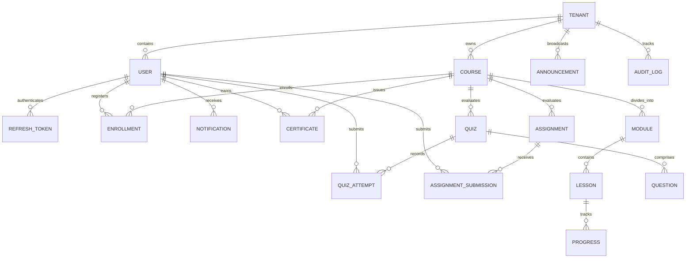

# EduSphere — Database & Entity Data Model

**Target Database:** MongoDB 8.x with Mongoose ODM  
**Multi-Tenancy Partitioning:** Logical Isolation via `tenantId` (ObjectId)  
**Document Version:** 1.0.0  

---

## 1. Entity-Relationship Overview



---

## 2. Core Collections & Schema Specifications

### 2.1 Tenant (`tenants`)
Represents an independent organization (University, College, Training Institute).

```typescript
interface ITenant {
  _id: ObjectId;
  name: string;                  // e.g. "Apex University"
  slug: string;                  // Unique subdomain slug, e.g. "apex-uni"
  domain?: string;               // Optional custom domain, e.g. "lms.apex.edu"
  logoUrl?: string;
  primaryColor?: string;         // Branding, e.g. "#2563EB"
  status: 'ACTIVE' | 'SUSPENDED' | 'TRIAL';
  settings: {
    allowSelfRegistration: boolean;
    maxStudents: number;
    maxCourses: number;
    storageQuotaBytes: number;
    requireMFA: boolean;
  };
  contactEmail: string;
  createdAt: Date;
  updatedAt: Date;
}
```
**Indexes:**
- `{ slug: 1 }` (Unique)
- `{ domain: 1 }` (Unique, Sparse)
- `{ status: 1 }`

---

### 2.2 User (`users`)
Represents members of tenants or platform administrators.

```typescript
interface IUser {
  _id: ObjectId;
  tenantId?: ObjectId;           // Null only for global SUPER_ADMIN
  email: string;                 // Email address
  passwordHash: string;          // Argon2id hash
  firstName: string;
  lastName: string;
  avatarUrl?: string;
  role: 'SUPER_ADMIN' | 'TENANT_ADMIN' | 'INSTRUCTOR' | 'STUDENT';
  status: 'ACTIVE' | 'PENDING_VERIFICATION' | 'INACTIVE' | 'SUSPENDED';
  authProvider: 'LOCAL' | 'GOOGLE' | 'GITHUB';
  providerId?: string;
  lastLoginAt?: Date;
  createdAt: Date;
  updatedAt: Date;
}
```
**Indexes:**
- `{ tenantId: 1, email: 1 }` (Unique Compound Index - enforces email uniqueness per tenant)
- `{ role: 1 }`
- `{ tenantId: 1, status: 1 }`

---

### 2.3 RefreshToken (`refresh_tokens`)
Tracks active session refresh tokens for cryptographic rotation and family reuse detection.

```typescript
interface IRefreshToken {
  _id: ObjectId;
  userId: ObjectId;
  tenantId?: ObjectId;
  tokenHash: string;             // SHA-256 hashed token secret
  familyId: string;              // UUID grouping tokens across rotations
  isRevoked: boolean;
  expiresAt: Date;               // MongoDB TTL index
  userAgent?: string;
  ipAddress?: string;
  createdAt: Date;
}
```
**Indexes:**
- `{ tokenHash: 1 }` (Unique)
- `{ familyId: 1 }`
- `{ expiresAt: 1 }` (TTL: `expireAfterSeconds: 0`)

---

### 2.4 Course (`courses`)
The central educational resource owned by a tenant.

```typescript
interface ICourse {
  _id: ObjectId;
  tenantId: ObjectId;
  instructorId: ObjectId;        // Ref: User
  title: string;
  slug: string;                  // URL-friendly identifier within tenant
  description: string;
  thumbnailUrl?: string;
  category: string;              // e.g. "Computer Science", "Data Engineering"
  level: 'BEGINNER' | 'INTERMEDIATE' | 'ADVANCED';
  status: 'DRAFT' | 'PUBLISHED' | 'ARCHIVED';
  price: number;                 // 0 for free/internal courses
  enrolledCount: number;         // Denormalized counter for sorting
  ratingAverage: number;
  tags: string[];
  createdAt: Date;
  updatedAt: Date;
}
```
**Indexes:**
- `{ tenantId: 1, slug: 1 }` (Unique Compound)
- `{ tenantId: 1, status: 1, category: 1 }` (Catalog filter)
- `{ tenantId: 1, instructorId: 1 }` (Instructor dashboard)
- `{ tenantId: 1, enrolledCount: -1 }` (Popular courses query)

---

### 2.5 Module (`modules`) & Lesson (`lessons`)
Structural curriculum entities within courses.

```typescript
interface IModule {
  _id: ObjectId;
  tenantId: ObjectId;
  courseId: ObjectId;
  title: string;
  order: number;
  description?: string;
  createdAt: Date;
}

interface ILesson {
  _id: ObjectId;
  tenantId: ObjectId;
  courseId: ObjectId;
  moduleId: ObjectId;
  title: string;
  order: number;
  contentType: 'VIDEO' | 'MARKDOWN' | 'PDF' | 'AUDIO';
  contentUrl?: string;           // Media asset URL
  textContent?: string;          // Rich text / markdown content
  durationSeconds: number;
  isFreePreview: boolean;
  createdAt: Date;
}
```
**Indexes:**
- Modules: `{ tenantId: 1, courseId: 1, order: 1 }`
- Lessons: `{ tenantId: 1, moduleId: 1, order: 1 }`
- Lessons: `{ tenantId: 1, courseId: 1 }`

---

### 2.6 Enrollment (`enrollments`) & Progress (`lesson_progress`)
Tracks student participation and granular completion state.

```typescript
interface IEnrollment {
  _id: ObjectId;
  tenantId: ObjectId;
  studentId: ObjectId;           // Ref: User
  courseId: ObjectId;            // Ref: Course
  status: 'ACTIVE' | 'COMPLETED' | 'DROPPED';
  progressPercentage: number;    // 0 - 100
  enrolledAt: Date;
  completedAt?: Date;
  lastAccessedAt: Date;
}

interface ILessonProgress {
  _id: ObjectId;
  tenantId: ObjectId;
  studentId: ObjectId;
  lessonId: ObjectId;
  courseId: ObjectId;
  isCompleted: boolean;
  secondsWatched?: number;
  completedAt?: Date;
}
```
**Indexes:**
- Enrollments: `{ tenantId: 1, studentId: 1, courseId: 1 }` (Unique Compound)
- Enrollments: `{ tenantId: 1, courseId: 1, status: 1 }`
- LessonProgress: `{ tenantId: 1, studentId: 1, lessonId: 1 }` (Unique Compound)

---

### 2.7 Quiz (`quizzes`), Question (`questions`), & QuizAttempt (`quiz_attempts`)
Evaluations, assessments, and submission records.

```typescript
interface IQuiz {
  _id: ObjectId;
  tenantId: ObjectId;
  courseId: ObjectId;
  title: string;
  description?: string;
  passingScorePercentage: number; // e.g. 70
  timeLimitMinutes: number;       // 0 for untimed
  maxAttempts: number;            // e.g. 3
  status: 'DRAFT' | 'PUBLISHED';
  createdAt: Date;
}

interface IQuestion {
  _id: ObjectId;
  tenantId: ObjectId;
  quizId: ObjectId;
  prompt: string;
  questionType: 'MULTIPLE_CHOICE' | 'MULTI_SELECT' | 'TRUE_FALSE';
  options: {
    id: string;
    text: string;
    isCorrect: boolean;
  }[];
  explanation?: string;
  points: number;
}

interface IQuizAttempt {
  _id: ObjectId;
  tenantId: ObjectId;
  quizId: ObjectId;
  studentId: ObjectId;
  courseId: ObjectId;
  answers: {
    questionId: ObjectId;
    selectedOptionIds: string[];
  }[];
  score: number;
  maxScore: number;
  percentage: number;
  passed: boolean;
  startedAt: Date;
  submittedAt: Date;
}
```
**Indexes:**
- Quizzes: `{ tenantId: 1, courseId: 1 }`
- Questions: `{ tenantId: 1, quizId: 1 }`
- QuizAttempts: `{ tenantId: 1, studentId: 1, quizId: 1 }`

---

### 2.8 Assignment (`assignments`) & Submission (`submissions`)
Homework, project files, and grading submissions.

```typescript
interface IAssignment {
  _id: ObjectId;
  tenantId: ObjectId;
  courseId: ObjectId;
  title: string;
  instructions: string;
  dueDate: Date;
  maxPoints: number;
  allowFileUpload: boolean;
  createdAt: Date;
}

interface ISubmission {
  _id: ObjectId;
  tenantId: ObjectId;
  assignmentId: ObjectId;
  studentId: ObjectId;
  courseId: ObjectId;
  content: string;
  fileAttachmentUrl?: string;
  status: 'SUBMITTED' | 'GRADED' | 'RESUBMIT_REQUESTED';
  grade?: number;
  feedback?: string;
  gradedBy?: ObjectId;
  submittedAt: Date;
  gradedAt?: Date;
}
```
**Indexes:**
- Assignments: `{ tenantId: 1, courseId: 1, dueDate: 1 }`
- Submissions: `{ tenantId: 1, assignmentId: 1, studentId: 1 }` (Unique Compound)

---

### 2.9 Announcement (`announcements`) & Notification (`notifications`)
Communication broadcasts and individual notifications.

```typescript
interface IAnnouncement {
  _id: ObjectId;
  tenantId: ObjectId;
  courseId?: ObjectId;           // Optional: Course-specific or Tenant-wide
  authorId: ObjectId;            // Ref: User
  title: string;
  content: string;
  priority: 'LOW' | 'NORMAL' | 'HIGH';
  createdAt: Date;
}

interface INotification {
  _id: ObjectId;
  tenantId: ObjectId;
  recipientId: ObjectId;         // Ref: User
  title: string;
  body: string;
  type: 'COURSE_UPDATE' | 'QUIZ_GRADED' | 'ANNOUNCEMENT' | 'SYSTEM';
  linkUrl?: string;
  isRead: boolean;
  createdAt: Date;
}
```
**Indexes:**
- Announcements: `{ tenantId: 1, courseId: 1, createdAt: -1 }`
- Notifications: `{ tenantId: 1, recipientId: 1, isRead: 1, createdAt: -1 }`

---

### 2.10 Certificate (`certificates`) & AuditLog (`audit_logs`)
Credentials earned on completion and compliance logging.

```typescript
interface ICertificate {
  _id: ObjectId;
  tenantId: ObjectId;
  studentId: ObjectId;
  courseId: ObjectId;
  certificateCode: string;       // Unique verification hash
  issuedAt: Date;
  pdfUrl?: string;
}

interface IAuditLog {
  _id: ObjectId;
  tenantId?: ObjectId;
  userId?: ObjectId;
  action: string;                // e.g. "USER_LOGIN", "COURSE_DELETE", "ROLE_CHANGE"
  resourceType: string;
  resourceId?: string;
  details?: Record<string, unknown>;
  ipAddress?: string;
  userAgent?: string;
  timestamp: Date;
}
```
**Indexes:**
- Certificates: `{ certificateCode: 1 }` (Unique)
- Certificates: `{ tenantId: 1, studentId: 1, courseId: 1 }`
- AuditLogs: `{ tenantId: 1, timestamp: -1 }`
- AuditLogs: `{ timestamp: 1 }` (TTL: 90 days retention)
