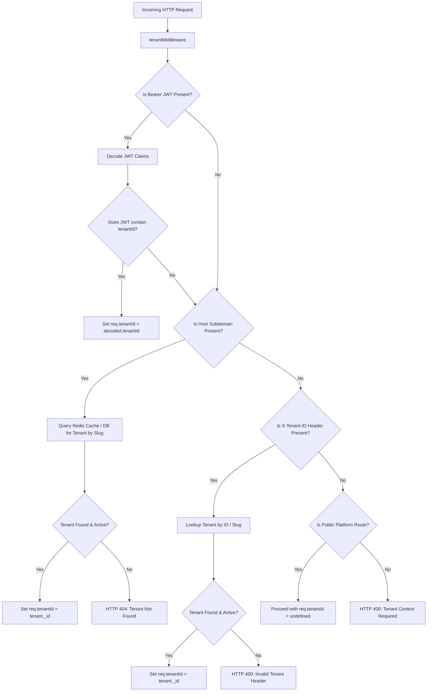

# EduSphere — Multi-Tenancy Architecture & Isolation Strategy

**Document Version:** 1.0.0  
**Domain:** Multi-Tenant SaaS LMS  
**Partitioning Model:** Logical Data Isolation via Discriminator (`tenantId`)

---

## 1. Multi-Tenancy Architectural Principles

EduSphere provides strict tenant isolation on a shared application and database tier. Tenants represent independent educational entities (e.g. "Apex University", "Oakridge College", "Summit Institute").

### Strategic Goals
1. **Zero Data Leakage:** A user from Tenant A must never be able to view, query, modify, or infer data from Tenant B.
2. **Subdomain Customization:** Each tenant accesses the platform via dedicated subdomain routing (e.g., `apex.edusphere.io` or `oakridge.edusphere.io`) or tenant slug context.
3. **Transparent Developer Experience:** Business logic developers should not need to write manual `{ tenantId: ... }` boilerplate on every database filter. The repository layer enforces this automatically.

---

## 2. Tenant Resolution Lifecycle



---

## 3. BaseRepository Tenant Scoping Pattern

The `BaseRepository<T>` forms the foundation for all database interactions. It guarantees that queries are partitioned:

```typescript
export abstract class BaseRepository<T extends { tenantId?: Types.ObjectId }> {
  protected readonly model: Model<T>;

  constructor(model: Model<T>) {
    this.model = model;
  }

  protected applyTenantFilter(
    filter: FilterQuery<T>,
    tenantId?: Types.ObjectId | string
  ): FilterQuery<T> {
    if (!tenantId) {
      throw new TenantIsolationError('Tenant context is required for this operation');
    }
    return { ...filter, tenantId: new Types.ObjectId(tenantId) };
  }

  async findById(id: string, tenantId: string): Promise<T | null> {
    return this.model.findOne(
      this.applyTenantFilter({ _id: id } as FilterQuery<T>, tenantId)
    ).exec();
  }

  async findPaginated(
    filter: FilterQuery<T>,
    tenantId: string,
    options: PaginationOptions
  ): Promise<PaginatedResult<T>> {
    const tenantFilter = this.applyTenantFilter(filter, tenantId);
    const skip = (options.page - 1) * options.limit;
    
    const [items, total] = await Promise.all([
      this.model.find(tenantFilter).sort(options.sort).skip(skip).limit(options.limit).exec(),
      this.model.countDocuments(tenantFilter).exec()
    ]);

    return {
      items,
      total,
      page: options.page,
      limit: options.limit,
      totalPages: Math.ceil(total / options.limit),
      hasNext: skip + items.length < total,
      hasPrev: options.page > 1
    };
  }
}
```

---

## 4. Cross-Tenant Breach Prevention Testing

To definitively prove isolation for academic evaluations and security audits:

1. **Test Scenario 1 (Direct ID Access):**
   - User from Tenant 1 attempts `GET /api/v1/courses/:tenant2CourseId`.
   - Result: HTTP 404 (Resource not found in tenant space) or HTTP 403 (Forbidden).
2. **Test Scenario 2 (Malicious Mutation):**
   - User from Tenant 1 attempts `PUT /api/v1/courses/:tenant2CourseId`.
   - Result: HTTP 404/403. Course in Tenant 2 remains completely unchanged.
3. **Test Scenario 3 (WebSocket Broadcast Eavesdropping):**
   - User from Tenant 1 connects to WebSocket and emits `join_room` for `tenant:tenant2Id`.
   - Result: Server immediately drops connection or emits `unauthorized_room_access` error.
4. **Test Scenario 4 (Header Injection Bypass):**
   - Authenticated user from Tenant 1 passes header `X-Tenant-ID: tenant2Id`.
   - Result: Middleware prioritizes verified JWT token over untrusted header and enforces Tenant 1 context, completely ignoring the spoofed header.
