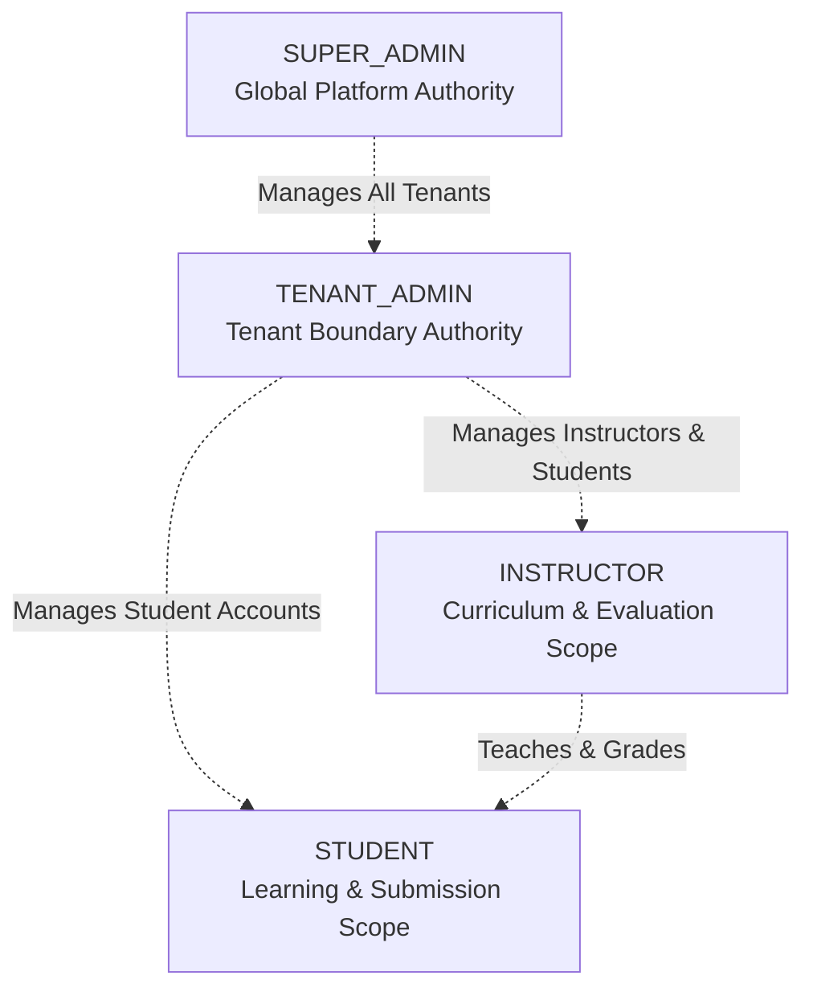

# EduSphere — Role-Based Access Control (RBAC) Specification

**Document Version:** 1.0.0  
**Roles Defined:** `SUPER_ADMIN`, `TENANT_ADMIN`, `INSTRUCTOR`, `STUDENT`  
**Enforcement:** Backend Middleware (`rbac.middleware.ts`) + Route Guarding (`ProtectedRoute.tsx`)

---

## 1. Role Hierarchy & Principles

EduSphere enforces strict, multi-tenant Role-Based Access Control.



### Core Security Rules
1. **Never Trust the Client:** Client-side UI conditional rendering is solely for user convenience. The backend middleware intercepts and verifies every request using the JWT payload and database context.
2. **Tenant Scoping Invariant:** Even if a user possesses `TENANT_ADMIN` or `INSTRUCTOR` role, they are strictly prohibited from performing actions outside their assigned `tenantId`.
3. **SUPER_ADMIN Boundary:** Global `SUPER_ADMIN` acts across tenants for platform maintenance, billing, provisioning, and audits, but does not own educational enrollments or curriculum content.

---

## 2. Granular Permissions Matrix

| Domain Area | Action / Permission | SUPER_ADMIN | TENANT_ADMIN | INSTRUCTOR | STUDENT |
|:---|:---|:---:|:---:|:---:|:---:|
| **Tenants** | List all tenants on platform | ✅ | ❌ | ❌ | ❌ |
| | Create new tenant organization | ✅ | ❌ | ❌ | ❌ |
| | Edit tenant settings & quotas | ✅ | ✅ (Own) | ❌ | ❌ |
| | Suspend or delete tenant | ✅ | ❌ | ❌ | ❌ |
| **Users** | Create global admins | ✅ | ❌ | ❌ | ❌ |
| | Manage tenant users (Instructors/Students) | ✅ | ✅ (Own Tenant) | ❌ | ❌ |
| | Assign/Revoke roles | ✅ | ✅ (Within Tenant) | ❌ | ❌ |
| | View tenant user directory | ✅ | ✅ (Own Tenant) | ✅ (Students in course) | ❌ |
| | Edit own profile / credentials | ✅ | ✅ | ✅ | ✅ |
| **Courses** | View public / enrolled course catalog | ✅ | ✅ | ✅ | ✅ (Own Tenant) |
| | Create new course | ✅ | ✅ | ✅ | ❌ |
| | Edit course content & syllabus | ✅ | ✅ | ✅ (Own Courses) | ❌ |
| | Publish / Archive course | ✅ | ✅ | ✅ (Own Courses) | ❌ |
| | Delete course | ✅ | ✅ | ❌ (Soft delete own) | ❌ |
| **Curriculum** | Add/Edit modules & lessons | ✅ | ✅ | ✅ (Own Courses) | ❌ |
| | Upload video / study material | ✅ | ✅ | ✅ (Own Courses) | ❌ |
| | View lesson content | ✅ | ✅ | ✅ | ✅ (If Enrolled) |
| | Track / Complete lesson progress | ❌ | ❌ | ❌ | ✅ (Own) |
| **Enrollments**| Enroll students administratively | ✅ | ✅ | ❌ | ❌ |
| | Self-enroll in open courses | ❌ | ❌ | ❌ | ✅ (Own Tenant) |
| | View enrollment roster | ✅ | ✅ | ✅ (Own Courses) | ❌ |
| | Drop course enrollment | ✅ | ✅ | ❌ | ✅ (Own) |
| **Quizzes** | Create & configure quizzes | ✅ | ✅ | ✅ (Own Courses) | ❌ |
| | Author quiz questions & answer keys | ✅ | ✅ | ✅ (Own Courses) | ❌ |
| | Attempt quiz & submit answers | ❌ | ❌ | ❌ | ✅ (If Enrolled) |
| | View quiz submission results & review | ✅ | ✅ | ✅ (Own Courses) | ✅ (Own attempts) |
| **Assignments**| Create assignments & deadlines | ✅ | ✅ | ✅ (Own Courses) | ❌ |
| | Submit assignment work/files | ❌ | ❌ | ❌ | ✅ (If Enrolled) |
| | Grade submission & provide feedback | ✅ | ✅ | ✅ (Own Courses) | ❌ |
| | View grade & instructor feedback | ✅ | ✅ | ✅ (Own Courses) | ✅ (Own submissions) |
| **Announcements**| Post tenant-wide announcement | ✅ | ✅ | ❌ | ❌ |
| | Post course announcement | ✅ | ✅ | ✅ (Own Courses) | ❌ |
| | Read announcements | ✅ | ✅ | ✅ | ✅ |
| **Analytics** | Platform-wide metrics & telemetry | ✅ | ❌ | ❌ | ❌ |
| | Tenant retention & completion rates | ✅ | ✅ | ❌ | ❌ |
| | Course-level student engagement | ✅ | ✅ | ✅ (Own Courses) | ❌ |
| | Personal learning stats & transcripts | ❌ | ❌ | ❌ | ✅ (Own) |
| **Audit Logs** | View system compliance audit logs | ✅ | ✅ (Own Tenant) | ❌ | ❌ |

---

## 3. Middleware Implementation Architecture

Backend endpoints declare required permissions or roles via clean decorator or pipeline middleware:

```typescript
// Example Route Declaration
router.post(
  '/courses',
  authenticateJwt,
  resolveTenant,
  requireRole(['SUPER_ADMIN', 'TENANT_ADMIN', 'INSTRUCTOR']),
  validateBody(createCourseSchema),
  courseController.createCourse
);

// Granular Ownership Guard for Course Mutation
router.put(
  '/courses/:id',
  authenticateJwt,
  resolveTenant,
  requireRole(['SUPER_ADMIN', 'TENANT_ADMIN', 'INSTRUCTOR']),
  verifyCourseOwnership, // Verifies instructorId === req.user.id if role is INSTRUCTOR
  validateBody(updateCourseSchema),
  courseController.updateCourse
);
```
