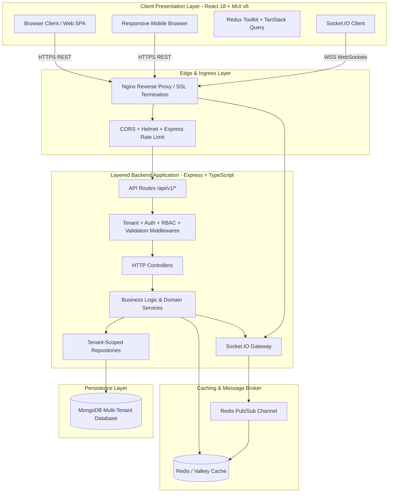
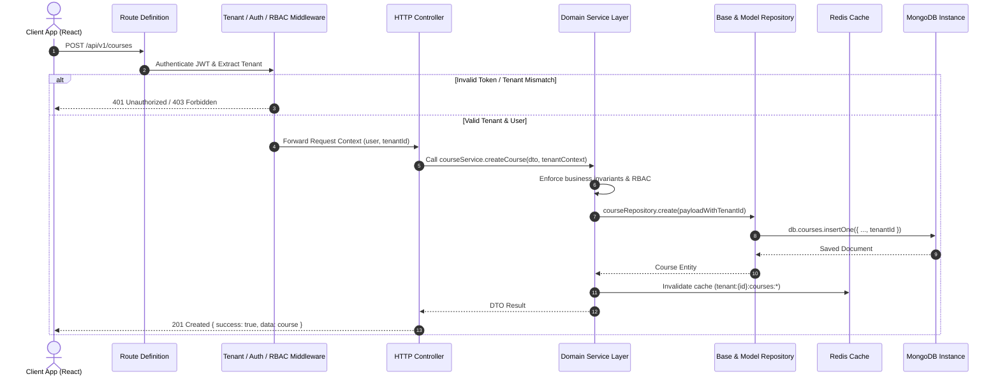
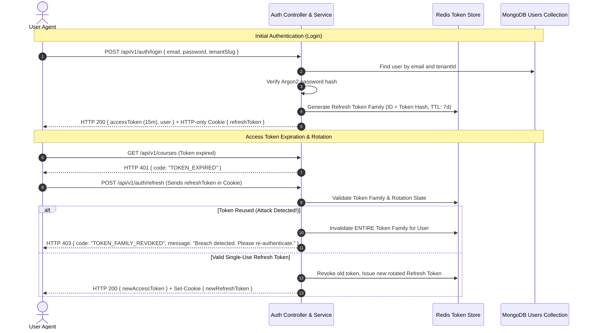

# EduSphere — System Architecture Document

**Platform:** EduSphere Multi-Tenant Enterprise Learning Management System  
**Document Version:** 1.0.0  
**Target Architecture:** Multi-Tenant SaaS Web Platform  
**Mapped Courses:** CAP646 & CAP774  

---

## 1. High-Level Architecture Topology

EduSphere is structured as a decoupled, multi-tenant enterprise web application leveraging a layered micro-modular architecture.



---

## 2. Layered Backend Architecture Pattern

EduSphere enforces a strict **6-tier backend architecture**. Business logic is strictly prohibited in route handlers and controllers.



### Layer Responsibilities

1. **Routes Layer (`backend/src/routes/`):**
   - Declares REST paths (`/api/v1/...`).
   - Chains appropriate middleware pipelines (Validation, Auth, RBAC, Rate-limiting).
   - Maps HTTP methods to specific controller functions.

2. **Middleware Layer (`backend/src/middleware/`):**
   - **`tenant.middleware.ts`**: Resolves tenant via Subdomain (`tenant1.edusphere.io`), Header (`X-Tenant-ID`), or JWT claim. Attaches `req.tenant` to request.
   - **`auth.middleware.ts`**: Verifies Bearer JWT, inspects expiration, attaches `req.user`.
   - **`rbac.middleware.ts`**: Checks `req.user.role` and specific resource permissions.
   - **`validate.middleware.ts`**: Validates request body, params, and queries using Zod schemas. Centralizes schema rejection with HTTP 422.
   - **`cache.middleware.ts`**: Checks Redis for cached GET responses before hitting services.

3. **Controller Layer (`backend/src/controllers/`):**
   - Parses HTTP inputs (`req.body`, `req.params`, `req.query`).
   - Extracts tenant and user context from `req`.
   - Delegates work to the appropriate Service class.
   - Formats the standardized HTTP response:
     ```json
     {
       "success": true,
       "message": "Resource retrieved successfully",
       "data": { ... },
       "meta": {
         "page": 1,
         "limit": 20,
         "total": 142,
         "totalPages": 8
       }
     }
     ```

4. **Service Layer (`backend/src/services/`):**
   - Pure business logic and domain rules.
   - Orchestrates multi-repository transactions where needed.
   - Emits domain events to WebSocket gateways and notification dispatchers.
   - Interacts with Redis caching (Cache-Aside pattern).

5. **Repository Layer (`backend/src/repositories/`):**
   - Encapsulates database queries and persistence details.
   - Extends `BaseRepository<T>` which automatically injects `{ tenantId }` into all queries (`find`, `findOne`, `update`, `delete`).
   - Prevents SQL/NoSQL injection through typed query builders.
   - Implements projection and indexing optimizations.

6. **Database Layer (`backend/src/models/`):**
   - Defines Mongoose schemas with strict types, indexes, and schema-level validation.
   - Compound indexes guarantee high-performance queries under tenant partitioning.

---

## 3. Multi-Tenancy Architecture & Isolation Model

EduSphere utilizes a **Shared Database, Shared Process, Discriminator-Isolated Architecture** (Logical Isolation).

### Multi-Tenancy Strategy Comparison

| Approach | Isolation Level | Resource Overhead | Operational Complexity | Cost | EduSphere Decision |
|:---|:---:|:---:|:---:|:---:|:---|
| **Database-per-Tenant** | High | Very High (DB connection pools per tenant) | High (migrations across N DBs) | High | Overkill for academic/SaaS prototype |
| **Schema-per-Tenant** | Medium-High | Medium | Medium (multi-connection switching) | Medium | Not native in standard MongoDB |
| **Shared DB with Discriminator Column (`tenantId`)** | High (with strict repository enforcement) | Very Low | Low (single migration pipeline, unified backups) | Optimal | **SELECTED (Industry Standard for scalable SaaS)** |

### Isolation Enforcement Guarantees

1. **Resolution Priority:**
   1. JWT Claim (`req.user.tenantId`) — Highest authority for authenticated users.
   2. Subdomain (`req.headers.host` -> `subdomain.edusphere.com`).
   3. Custom Request Header (`X-Tenant-ID`) — For dev and API clients.

2. **Repository-Level Invariant:**
   Every query executed through `BaseRepository` must supply `tenantId`. If a query attempts to access an entity belonging to a different tenant ID, the query returns `null` or throws `TenantIsolationError` (HTTP 403 Forbidden).

3. **Mongoose Plugin Level Invariant:**
   A global tenant discriminator plugin intercepts Mongoose `pre('find')`, `pre('findOne')`, `pre('findOneAndUpdate')`, and `pre('countDocuments')` to verify that `tenantId` is included in the query filter.

---

## 4. Authentication & Token Lifecycle



---

## 5. Real-Time WebSocket Architecture

EduSphere incorporates real-time collaborative and push capabilities via Socket.IO:

- **Authentication Handshake:** Sockets authenticate during connection using JWT Bearer token in `auth.token`.
- **Tenant Room Isolation:** Upon connection, sockets join:
  - `tenant:{tenantId}` — Tenant-wide announcements and operational alerts.
  - `tenant:{tenantId}:course:{courseId}` — Course-level live classroom, chat, and instant activity updates.
  - `user:{userId}` — Direct personal notifications (quiz graded, assignment reviewed).
- **Security Check:** Socket handlers reject room subscriptions if the user's decoded token does not match the room's tenant ID.

---

## 6. Redis Caching Topology

EduSphere applies the **Cache-Aside (Lazy Loading)** caching pattern with active cache invalidation:

1. **Key Naming Convention:**
   `tenant:{tenantId}:{entity}:{scope}:{identifier}`
   - Example 1: `tenant:660a12e:courses:popular` (TTL: 1 hour)
   - Example 2: `tenant:660a12e:dashboard:stats` (TTL: 15 minutes)
   - Example 3: `tenant:660a12e:settings:branding` (TTL: 24 hours)

2. **Cache Invalidation Lifecycle:**
   Whenever a mutation occurs (e.g. `courseService.updateCourse`), the service triggers cache invalidation matching the tenant pattern (`tenant:{tenantId}:courses:*`) to guarantee read consistency.
