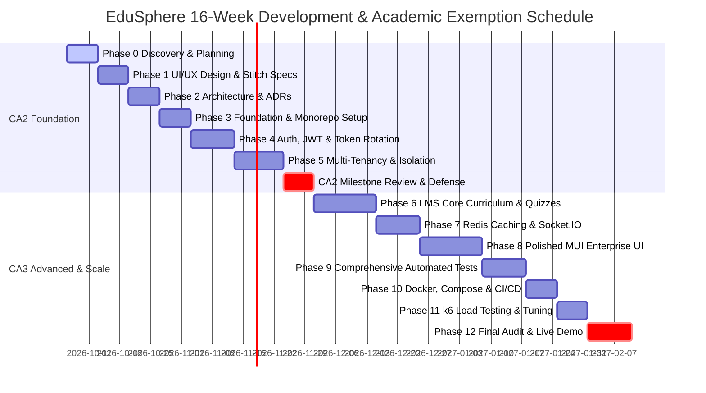

# EduSphere — 16-Week Capstone Engineering Roadmap

**Project ID:** PGY2-01  
**Project Title:** Full-Stack Enterprise Web Platform (EduSphere)  
**Target Semester:** 16-Week Academic Term  
**Mapped Courses:** CAP646 & CAP774  
**Milestone Gates:** CA2 Evaluation Gate (Week 8) & CA3 Final Exemption Gate (Week 15-16)  

---

## 1. Roadmap Overview & Academic Milestones

---

## 2. Detailed Weekly Breakdown & Deliverables

### Part I: CA2 Evaluation Scope (Weeks 1–8)

#### Week 1: Phase 0 — Project Discovery & Requirements Traceability
- Workspace inspection, tool verification (Node, Mongo, Redis).
- Establish Requirement Traceability Matrix (`docs/requirement-traceability.md`).
- Define sprint cadence and Git commit conventions.
- **Deliverables:** RTM initialized, discovery notes approved.

#### Week 2: Phase 1 — Product Persona & Design System Architecture
- Define personas: Super Admin, Tenant Admin, Instructor, Student.
- Execute UI UX Pro Max design intelligence query (`Plus Jakarta Sans`, Cobalt palette).
- Generate initial Stitch wireframes and responsive layouts for core pages.
- **Deliverables:** Design tokens, UI UX specification, Stitch screen plan.

#### Week 3: Phase 2 — System Architecture & ADR Formulation
- Formalize 6-tier backend architecture (Route → Middleware → Controller → Service → Repo → DB).
- Author 10 Architecture Decision Records (ADR-001 through ADR-010).
- Draft MongoDB entity model with compound indexing strategies.
- **Deliverables:** Architecture specs, ER diagrams, ADR documents.

#### Week 4: Phase 3 — Monorepo Scaffolding & Foundational Core
- Scaffold `backend/` (TypeScript, Express, Mongoose, Zod, Vitest) and `frontend/` (Vite, React 18, TypeScript, MUI v6, Redux Toolkit).
- Configure environment loaders, Winston logger, and centralized error handling middleware.
- Connect local MongoDB and Redis instances with automated health checks.
- **Deliverables:** Cleanly running backend and frontend dev servers.

#### Week 5: Phase 4 — Enterprise Authentication & Security
- Implement Argon2id password hashing, user registration, and login.
- Implement dual-token strategy: 15-minute Access Token + 7-day Refresh Token.
- Implement Refresh Token Rotation with token family tracking in Redis to prevent replay attacks.
- Configure Google OAuth2 social login endpoints and state validation.
- **Deliverables:** Auth service, auth middleware, token rotation test suite.

#### Week 6: Phase 5 — Multi-Tenancy Engine & Tenant Isolation
- Implement Tenant Model with slug, custom domains, and branding settings.
- Build `tenant.middleware.ts` for subdomain/header/JWT resolution.
- Build generic `BaseRepository<T>` with mandatory tenant scoping.
- Write negative test suite for cross-tenant boundary isolation.
- **Deliverables:** Multi-tenancy engine, tenant isolation tests (`tests/integration/tenant-isolation.spec.ts`).

#### Week 7: Phase 5 (Cont.) — RBAC Middleware & Security Hardening
- Implement `rbac.middleware.ts` for role checking (SUPER_ADMIN, TENANT_ADMIN, INSTRUCTOR, STUDENT).
- Implement rate limiting (Express Rate Limit) and secure headers (Helmet).
- Validate all incoming payloads with Zod schemas.
- **Deliverables:** Security-hardened REST endpoints, RBAC unit tests.

#### Week 8: CA2 Evaluation Checkpoint & Faculty Defense
- Conduct live presentation of layered architecture, JWT rotation, and multi-tenant isolation.
- Demonstrate automated unit and integration tests passing.
- **Deliverable for CA2:** Comprehensive CA2 technical report & live API demo.

---

### Part II: CA3 Advanced Enterprise Scale (Weeks 9–16)

#### Weeks 9–10: Phase 6 — Core LMS Curriculum & Assessment Engines
- Course authoring: Draft, Published, Archived lifecycle.
- Module and Lesson management supporting Video, Markdown, and Resources.
- Student Enrollment and granular Lesson Progress tracking.
- Quiz Engine: Multiple choice, auto-grading, attempt history, score thresholds.
- Assignment Engine: Submission tracking, instructor grading, and feedback loops.
- **Deliverables:** Full LMS curriculum lifecycle, grading services, and integration tests.

#### Week 11: Phase 7 — Real-Time WebSockets & Redis Performance Caching
- Setup Socket.IO with JWT authentication and isolated rooms (`tenant:{id}`, `course:{id}`).
- Real-time instant announcements, course chat, and unread notification badges.
- Implement Redis cache-aside caching on popular course queries and dashboard analytics.
- Implement active cache invalidation upon course mutations.
- **Deliverables:** Real-time dual-browser demo, cache hit/miss latency verification.

#### Week 12: Phase 8 — Advanced Responsive Frontend & Dashboards
- Super Admin Dashboard (Tenant management, platform telemetry).
- Tenant Admin Dashboard (User roster, course analytics, tenant settings).
- Instructor Dashboard (Course builder, student performance, grading center).
- Student Dashboard (Course player, interactive quiz runner, progress certificates).
- Full responsive optimization (375px mobile, 768px tablet, 1440px desktop).
- **Deliverables:** Polished enterprise UI, zero console errors, full accessibility compliance.

#### Week 13: Phase 9 — Comprehensive Automated Testing & E2E Validation
- Unit test coverage for services, repositories, and utilities (>80% coverage).
- Integration test suite with Supertest across all API v1 endpoints.
- Playwright E2E test suite covering critical user journeys:
  1. Student registration and enrollment
  2. Course creation and publishing
  3. Quiz completion and auto-grading
  4. Real-time announcement delivery
  5. Cross-tenant unauthorized access rejection.
- **Deliverables:** HTML coverage reports and Playwright test artifacts.

#### Week 14: Phase 10 — Containerization & CI/CD Pipeline
- Multi-stage Dockerfile for backend (Node 22 Alpine, non-root user).
- Multi-stage Dockerfile for frontend (Vite build + Nginx Alpine).
- `docker-compose.yml` for local multi-service startup (Backend, Frontend, MongoDB, Redis).
- GitHub Actions CI/CD pipeline (`.github/workflows/ci.yml`) automating lint, test, build, and image creation.
- **Deliverables:** Verified `docker compose up` command, passing GitHub Actions workflow.

#### Week 15: Phase 11 — k6 Load Testing & Optimization
- Author k6 load testing scenarios for authentication, catalog search, and dashboard telemetry.
- Execute concurrency runs (50, 100, 200 Virtual Users).
- Benchmark Redis cache impact (latency drop from ~120ms to <10ms p95).
- Compile formal Load Testing & Performance Report (`docs/performance/load-test-report.md`).
- **Deliverables:** k6 scripts, latency graphs, performance report.

#### Week 16: Phase 12 — Final Audit, Presentation & CA3 Exemption Defense
- Conduct final security, accessibility, and architectural audit.
- Seed realistic demo data for 2 tenants (Apex University & Oakridge College).
- Finalize all documentation, Swagger/OpenAPI, and Architecture Decision Records.
- Conduct final 22-step live demo scenario before faculty committee.
- **Deliverable:** Final submission package achieving CA2 + CA3 exemption.
